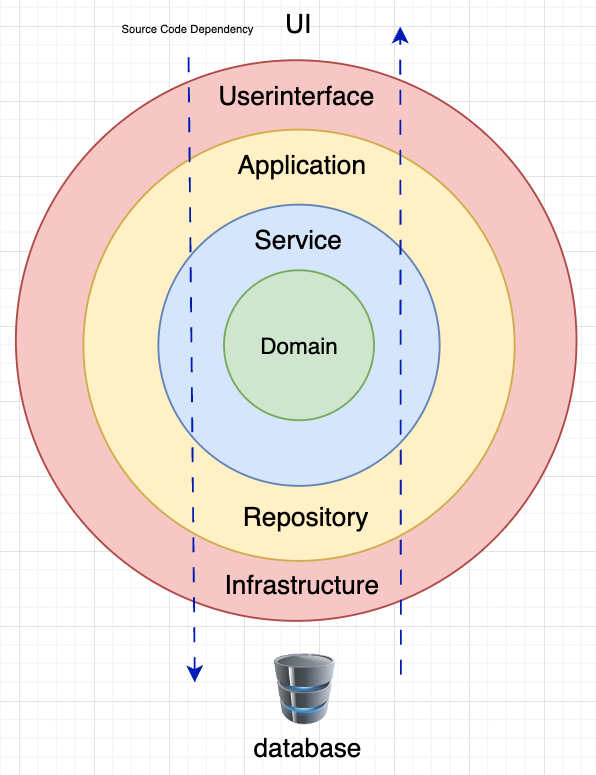
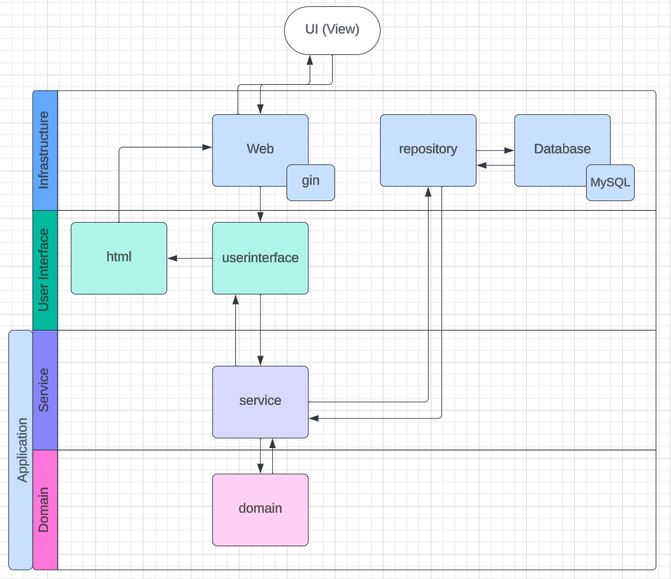

# go-api-arch-onion-template

## External apps

### Run

```bash
$ make external-up
```

### Stop

```bash
$ make external-down
```

### Connect to MySQL

```bash
$ make mysql-cli
```

## Run app

### Generate oapi codegen

```bash
$ make generate-code-from-openapi
```

### Run external-up if not running

```bash
$ make external-up
```

### Run app

```bash
$ make run
```

### API spec

| name                                | URL                                    |
|-------------------------------------|----------------------------------------|
| Swagger UI with docker              | http://0.0.0.0:8001/                   |
| Swagger UI with gin development env | http://0.0.0.0:8080/swagger/index.html |

## Run test

### Run unittest

```bash
$ make unittest
```

### Run integration test

```bash
$ make integration-test
```

## Format

### Run lint

```bash
$ make lint
```

## Diagram




